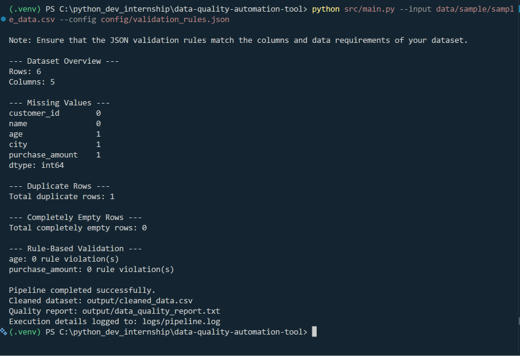
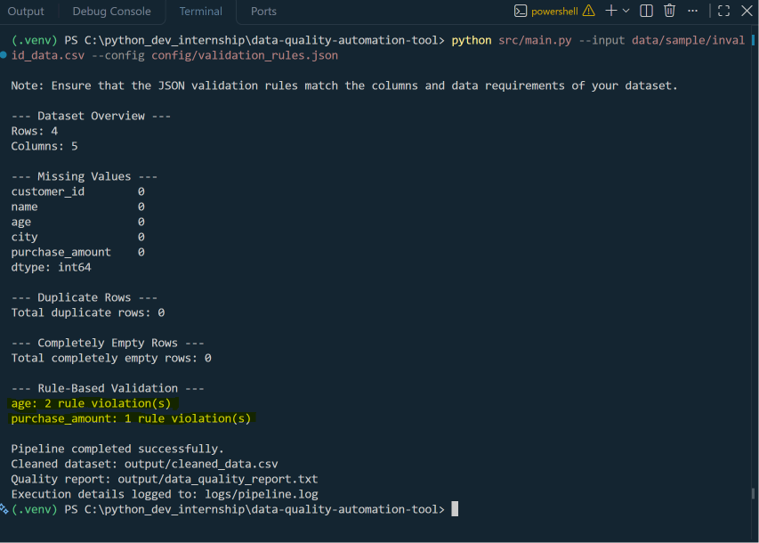
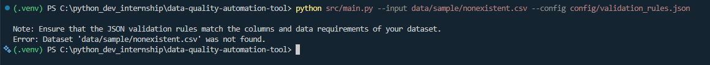
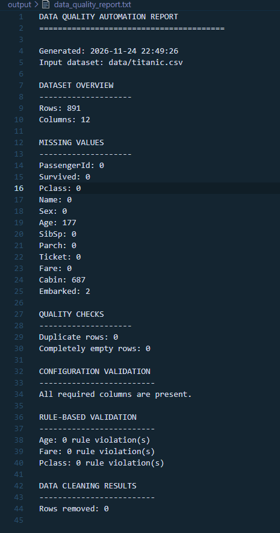
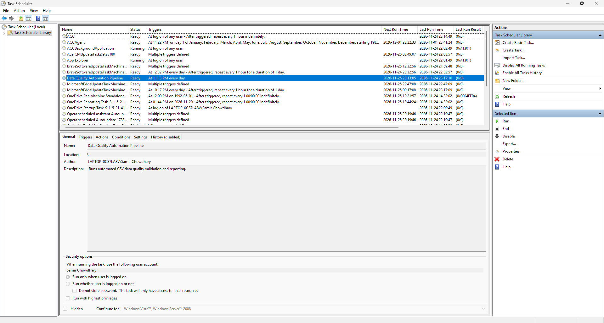

# Data Quality Automation Tool

A configurable Python CLI automation pipeline for analyzing CSV datasets, validating data against JSON-defined rules, performing safe cleaning, and generating automated data quality reports and execution logs.

Developed as part of the **Redynox Python Developer Internship (Task 2: Automation Script for Real-World Problem)**.

---

## Problem Statement

Data analysts and engineering teams frequently receive CSV files from external sources that contain missing values, duplicate records, empty rows, missing columns, or out-of-range numeric values. Manually inspecting every incoming file before reporting or downstream processing is repetitive and error-prone.

This tool automates initial data quality assessment, flags rule violations, safely removes duplicate and completely empty rows, and produces a standardized quality report alongside execution logs.

---

## Key Features

- **Generic CSV Processing:** Works with any CSV dataset without modifying Python source code.
- **JSON-Based Validation Rules:** Configurable required columns and numeric min/max bounds defined in external JSON files.
- **CLI Interface:** Accepts `--input` and `--config` arguments via `argparse` for repeatable, scriptable execution.
- **Safe Data Cleaning:** Removes exact duplicate rows and completely empty rows while preserving the original input dataset and avoiding destructive imputation.
- **Automated Reporting:** Generates a timestamped `output/data_quality_report.txt` summarizing dataset dimensions, missing values, duplicates, rule violations, and rows removed.
- **Execution Logging & Error Handling:** Logs pipeline runs and exceptions to `logs/pipeline.log` and handles missing files, empty CSVs, and invalid JSON gracefully.
- **Scheduling Support:** Designed for unattended periodic execution using OS-level schedulers such as **Windows Task Scheduler** or **Cron**.

---

## Project Structure

```text
data-quality-automation-tool/
├── config/
│   ├── validation_rules.json     # Validation rules for sample datasets
│   └── titanic_rules.json        # Validation rules for the Titanic dataset
├── data/
│   └── sample/
│       ├── sample_data.csv       # Sample dataset with missing values & duplicates
│       └── invalid_data.csv      # Sample dataset with numeric rule violations
├── docs/
│   ├── screenshots/              # Execution, report, and scheduling screenshots
│   └── task2_report.md           # Internship submission report
├── src/
│   └── main.py                   # Main CLI automation pipeline
├── .gitignore
├── README.md
└── requirements.txt
```

*(Note: `logs/`, `output/`, and external datasets like `data/titanic.csv` are excluded from version control via `.gitignore`.)*

---

## Setup & Installation

1. **Clone the repository:**
   ```bash
   git clone [https://github.com/SamirChowdhary24/data-quality-automation-tool.git](https://github.com/SamirChowdhary24/data-quality-automation-tool.git)
   cd data-quality-automation-tool
   ```

2. **Create and activate a virtual environment (Windows PowerShell):**
   ```powershell
   python -m venv .venv
   .\.venv\Scripts\Activate.ps1
   ```

3. **Install dependencies:**
   ```powershell
   pip install -r requirements.txt
   ```

---

## Usage

Run the pipeline by passing a CSV dataset and its corresponding JSON configuration file:

```powershell
python src/main.py --input data/sample/sample_data.csv --config config/validation_rules.json
```

### Example JSON Configuration (`config/validation_rules.json`)

```json
{
    "required_columns": [
        "customer_id",
        "name",
        "age",
        "city",
        "purchase_amount"
    ],
    "numeric_rules": {
        "age": {
            "min": 0,
            "max": 100
        },
        "purchase_amount": {
            "min": 0
        }
    }
}
```

### Generated Outputs
- **Cleaned Dataset:** `output/cleaned_data.csv`
- **Quality Report:** `output/data_quality_report.txt`
- **Execution Logs:** `logs/pipeline.log`

---

## Scheduling (Windows Task Scheduler)

To run the pipeline automatically on a schedule without modifying the Python code:

1. Open **Windows Task Scheduler** and select **Create Basic Task**.
2. Set a trigger (e.g., **Daily**).
3. Select **Start a program** and configure:
   - **Program/script:** `C:\path\to\data-quality-automation-tool\.venv\Scripts\python.exe`
   - **Add arguments:** `src/main.py --input data/sample/sample_data.csv --config config/validation_rules.json`
   - **Start in:** `C:\path\to\data-quality-automation-tool`

---

## Demonstration & Testing Results

### 1. Sample Dataset Execution
Detects missing values, duplicate rows, generates outputs, and prints console completion notifications.


### 2. Rule-Based Validation (Invalid Data)
Flags out-of-range numeric values defined in `validation_rules.json`.


### 3. Error Handling
Handles missing input files gracefully without crashing.


### 4. Automated Quality Report
Structured text report generated in `output/data_quality_report.txt`.


### 5. Scheduled Execution (Windows Task Scheduler)
Configured and verified unattended execution (`0x0` success status).
